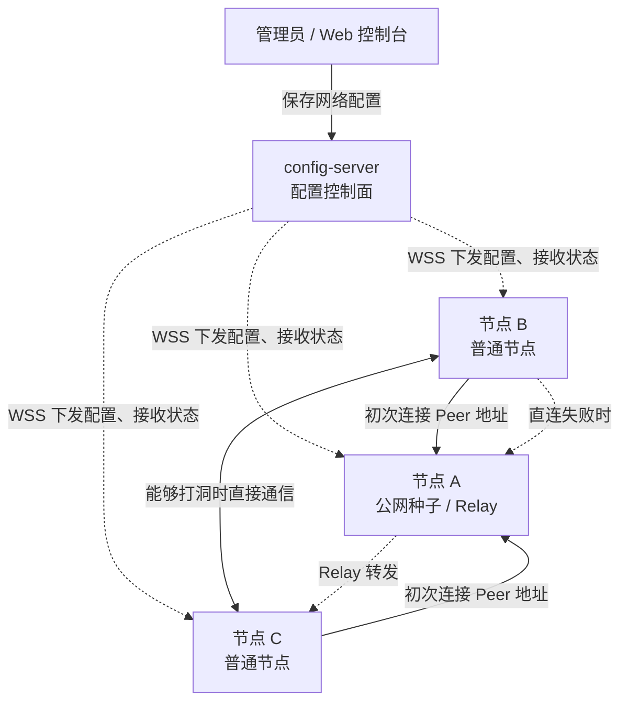
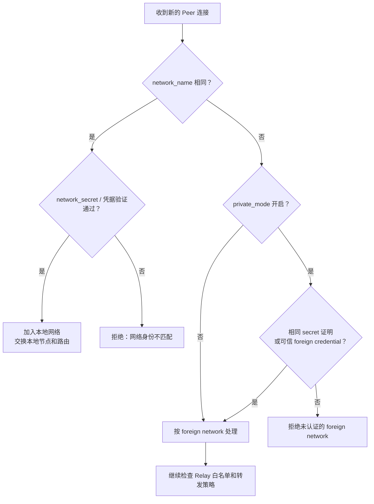
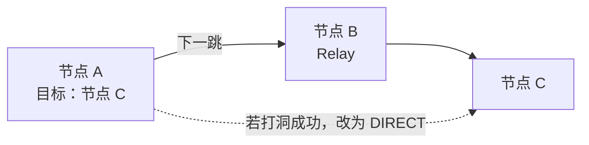
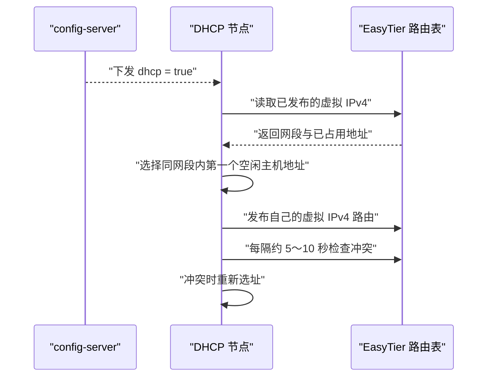
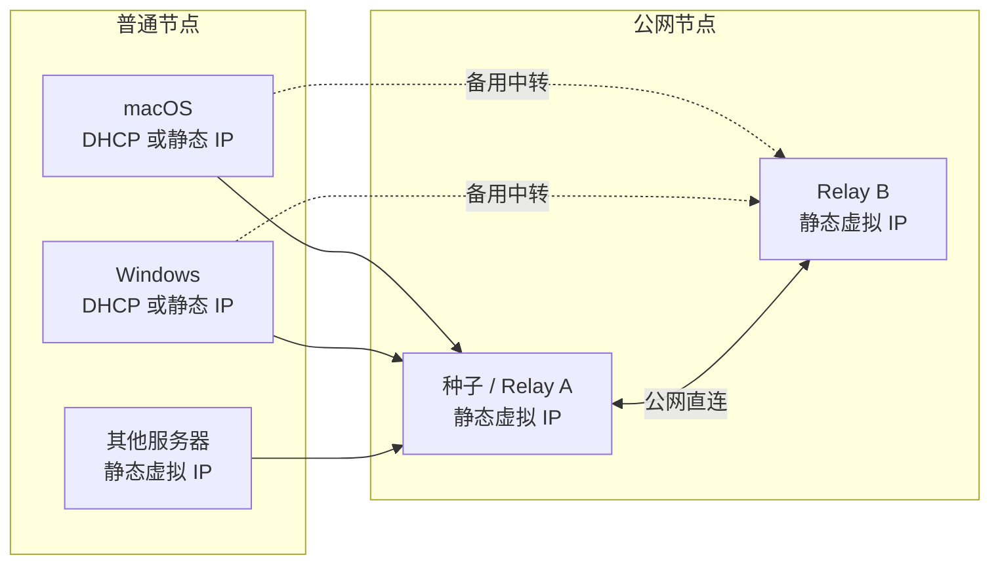

# EasyTier 核心概念与权限模型

> 本文用于理解 EasyTier v2.6.4 的组网逻辑。部署步骤、配置模板和验证命令见 [easytier.md](./easytier.md)。文中的域名、密码、节点名和地址均为示例或占位符。

## 先记住这张表

| 概念 | 负责什么 | 不负责什么 |
|---|---|---|
| `config-server` | 保存、下发配置，接收节点状态和日志 | 不发现业务 Peer，不转发虚拟网络流量 |
| 初始 Peer / 种子节点 | 让新节点首次进入网络并发现其他节点 | 不是配置服务器，也不要求永久承载所有流量 |
| P2P 直连 | 两个节点打洞或通过公网监听地址直接通信 | 不经过 Relay |
| Relay | 目标无法直连时，替其他节点转发数据 | 不负责给节点下发配置 |
| `network_name` | 标识网络、区分本地网络和 foreign network | 不是用户名，也不是认证凭据 |
| `network_secret` | 证明节点持有该网络的共享密钥 | 不是 config-server 登录密码，也不是节点个人密码 |
| `private_mode` | 拒绝未通过共享密钥或可信凭据认证的 foreign network | 不是防火墙，也不是简单的“网络名必须相同”开关 |
| Relay 网络白名单 | 按 `network_name` 控制或影响本节点的中继行为 | 不是密码认证，网络名本身可以被别人知道或仿冒 |
| DHCP | 每个节点根据分布式路由表为自己选择虚拟 IPv4 | 不依赖中心 DHCP 服务器 |
| QUIC 代理 | 将虚拟网络里的 TCP 流转换为 QUIC 传输以改善特定丢包链路 | 不等同于底层 Peer 隧道必须是 QUIC |

## 控制面与数据面

config-server、种子节点和 Relay 可以部署在同一台服务器上，但仍是三个不同角色。



其中：

- WSS 连接只承载配置管理，不承载节点间业务流量。
- 普通节点通过配置里的 `peers` 找到种子节点，然后交换节点和路由信息。
- 两端能够直连时，后续业务流量可以绕过种子节点。
- 直连失败时，路由表选择可用节点作为下一跳进行 Relay。

## 网络身份不是用户账号

`network_name` 和 `network_secret` 是两个独立变量，但它们不是“用户名和用户密码”。

```text
network_name   = 网络名称 / 命名空间
network_secret = 网络共享密钥 / 入网凭证
node identity  = 某个具体节点的 machine ID、实例 ID 或公钥
config token   = 节点连接 config-server 使用的控制面凭据
```

同一张普通 EasyTier 网络中的节点通常使用相同的 `network_name` 和 `network_secret`，但各自拥有不同的节点身份和虚拟 IP。

### `network_name` 的实际价值

`network_name` 不是安全秘密。它的主要用途是：

1. 判断一个连接属于本地网络还是 foreign network。
2. 在共享种子或 Relay 上区分多张网络。
3. 作为 Relay 网络白名单、日志和监控的网络标签。
4. 让网络名称保持稳定，同时独立轮换 `network_secret`。

如果所有人都使用默认名称，仅通过不同的 `network_secret` 组网，那么名称确实退化成固定常量。对于只有一张私有网络的部署，它主要起标识作用，不额外增加安全强度。

### `network_secret` 的实际价值

`network_secret` 是共享凭据。持有它的普通管理节点可以证明自己属于对应的信任域。它必须：

- 使用足够长的随机值；
- 在同一网络的节点之间保持一致；
- 只保存在服务器配置、受保护的 config-server 数据库或安全备份中；
- 不写入仓库、日志、聊天截图或公开脚本。

`network_secret` 只授予 EasyTier 网络身份，不等于服务器的 SSH、root 或 Web 管理权限。

## 私有模式如何判断

私有模式并非只检查网络名称。EasyTier 先用 `network_name` 判断对端是本地网络还是 foreign network，再使用共享密钥证明或可信凭据作认证决策。



常见组合如下：

| `network_name` | `network_secret` / 凭据 | `private_mode` | 结果 |
|---|---|---:|---|
| 相同 | 验证通过 | 开或关 | 作为本地网络节点加入 |
| 相同 | 验证失败 | 开或关 | 拒绝，不能冒充同网节点 |
| 不同 | 验证失败 | 关闭 | 可进入 foreign network 流程，随后仍受 Relay 策略限制 |
| 不同 | 验证失败 | 开启 | 拒绝 |
| 不同 | 相同共享密钥证明或可信凭据 | 开启 | 可认证，但仍被归类为 foreign network |

最后一行说明了 `network_name` 与 `network_secret` 的区别：两个网络可以共享同一信任凭据，但只要名称不同，拓扑仍不会被合并成同一张本地网络。

## Relay 与网络白名单

Relay 是一种数据路径。节点 A 到节点 C 无法直连时，A 会根据路由表把数据交给下一跳节点 B：



Relay 网络白名单按 `network_name` 匹配，并支持通配符。它适合做中继策略，但不是认证手段：知道一个被允许的网络名，并不等于获得该网络的 `network_secret`，反过来白名单本身也不能证明对端可信。

需要注意 v2.6.4 的两类行为：

- 对 foreign network：不在白名单时，通常拒绝其进入共享转发流程；`relay_all_peer_rpc` 可以例外转发控制 RPC，帮助其建立 P2P，但不等于允许业务数据中转。
- 对本地网络：不在白名单时会倾向避免使用本节点 Relay；如果没有其他可用路径，仍可能回退到该路径。

如果需要明确禁止本节点转发数据，应使用专门的“禁止 Relay 数据”选项，而不能把网络名白名单当成防火墙。公网入口仍应由云安全组和宿主机防火墙控制。

### 三种常见部署意图

| 目标 | 私有模式 | Relay 白名单 | 建议 |
|---|---:|---|---|
| 只服务自己的私有网络 | 开启 | 自己的 `network_name` | 推荐用于普通自建组网 |
| 给多个受控网络提供共享 Relay | 按凭据设计决定 | 明确列出允许的网络名 | 网络名白名单不能替代强认证 |
| 公共共享节点 | 关闭 | `*` 或公开策略 | 应增加限速、监控和独立实例，避免与私人节点混用 |

最容易维护的做法，是让私人组网节点保持 `private_mode = true`，不要同时承担面向陌生网络的公共 Relay。如果确实需要共享服务，优先运行独立 EasyTier 实例并隔离配置、端口和限速策略。

## 种子节点与节点发现

配置里的 `peers` 只是初始连接入口，不是所有流量必须经过的中心服务器。

节点启动后的典型过程是：

1. 从本地文件或 config-server 得到网络配置。
2. 连接一个初始 Peer，例如公网种子节点。
3. 交换本网络的节点、路由和可达信息。
4. 尝试与目标节点建立直接连接。
5. 打洞或公网直连成功后走 `DIRECT`。
6. 直连失败时，根据路由表选择 Relay 下一跳。

种子节点短暂离线不会把已经建立的所有直连立即变成经过 config-server 的连接，因为 config-server 不在数据路径中。不过，新节点冷启动、拓扑重新收敛和只配置了该种子的节点重连会受到影响，因此重要网络可以配置多个稳定的初始 Peer。

## config-server 管什么

config-server 是集中管理控制面。它可以保存并下发：

- `network_name`、`network_secret` 和私有模式；
- 每台节点的虚拟 IP 或 DHCP 设置；
- 初始 Peer、监听器和节点名称；
- 加密、QUIC 代理、Relay、路由等开关。

它不承担：

- Peer 发现；
- NAT 打洞；
- 虚拟 IP 数据包转发；
- Relay；
- DHCP 地址集中分配。

例如：

```text
wss://<CONFIG_SERVER_DOMAIN>/<NODE_TOKEN>
```

其中 `<NODE_TOKEN>` 是连接 config-server 的控制面凭据，不是 `network_name`。节点只连接 config-server、但尚未获得并运行网络配置时，可以出现在控制台中，却不会创建 EasyTier TUN 或加入虚拟网络。

## DHCP 由谁分配地址

EasyTier DHCP 不是传统的 DHCP Server/Client 模型，而是每个节点根据分布式路由表自行选址。



例如已有一个静态节点使用 `10.144.144.1/24`，DHCP 节点会基于路由表选择该 `/24` 中尚未使用的地址。v2.6.4 实现中的无已知 IPv4 网段回退值为 `10.126.126.0/24`；不要依赖默认值来规划生产网络。

推荐：

- 公网种子、Relay、需要固定 SSH 或监控目标的服务器使用静态虚拟 IP；
- Mac、Windows 等普通终端可以使用 DHCP；
- 静态地址和 DHCP 地址必须在同一规划网段内避免重复；
- 虚拟网段不要与本地局域网、云 VPC 或 Tailscale 的路由重叠。

## QUIC 代理的作用边界

`enable_quic_proxy` 优化的是虚拟网络中的 TCP 流。当源节点开启它，并且目标节点没有禁止 QUIC 入站时，EasyTier 可以使用 QUIC 承载该 TCP 流。

因此两端配置不同并不必然导致无法通信：

- 源节点开启、目标节点允许 QUIC 入站：可以尝试 QUIC 代理；
- 目标节点明确禁止 QUIC 入站：保留原始 TCP 连接；
- 未使用 QUIC 代理：普通 TCP/UDP 虚拟网络通信仍可正常进行。

QUIC 代理不代表 `easytier-cli peer` 中的底层隧道一定显示为 `quic`。Peer 隧道可能仍是 `tcp` 或 `udp`，而特定 TCP 流在虚拟网络内部由 QUIC 代理处理。

## 如何看直连和 Relay 路径

先查看直接连接和全网路由：

```bash
/opt/easytier/easytier-cli peer
/opt/easytier/easytier-cli route
```

`peer` 表显示本节点已经建立的直接 Peer 连接；目标只出现在 `route` 表而不在 `peer` 表时，通常需要经过其他节点。

`route` 表中的常用字段：

| 字段 | 含义 |
|---|---|
| `hostname` | 最终目标节点 |
| `next_hop_hostname` | 最少跳数策略采用的下一跳 |
| `path_len` | 最少跳数路径的长度；直连通常为 `1` |
| `path_latency` | 最少跳数路径的累计延迟 |
| `next_hop_hostname_lat_first` | 延迟优先策略采用的下一跳 |
| `path_len_lat_first` | 延迟优先路径的长度 |
| `path_latency_lat_first` | 延迟优先路径的累计延迟 |

判断方法：

```text
next_hop_hostname[_lat_first] = DIRECT
    -> 目标与本节点直连

next_hop_hostname[_lat_first] = 某个其他节点名
    -> 该节点就是当前策略选择的 Relay 下一跳
```

默认路由策略偏向最少跳数；启用 `latency_first` 后，业务发送会采用低成本/低延迟路径。此时观察带 `_lat_first` 后缀的字段，才能判断实际偏好的下一跳。

## 与 Tailscale 同时运行

EasyTier 与 Tailscale 可以同时安装，一般不会因为软件本身直接冲突。真正需要检查的是路由：

- 不要给两者配置重叠的虚拟网段；
- 不要让两者同时发布相同的子网路由；
- 谨慎启用默认路由或出口节点；
- DNS 被两套软件同时接管时，应明确决定由谁管理。

本仓库示例使用 `10.144.144.0/24`，应继续避开 Tailscale 使用的 `100.64.0.0/10`，也要避开实际局域网和云 VPC 网段。

## 推荐的私有组网结构



所有节点应统一：

```toml
[network_identity]
network_name = "<PRIVATE_NETWORK_NAME>"
network_secret = "${ET_NETWORK_SECRET}"

[flags]
private_mode = true
enable_encryption = true
enable_quic_proxy = true
latency_first = true
relay_network_whitelist = "<PRIVATE_NETWORK_NAME>"
```

每台节点必须不同：

- `instance_id` 或 machine ID；
- `instance_name` / hostname；
- 静态虚拟 IP；
- 需要直接连接时使用的公网监听地址。

普通节点的初始 `peers` 指向一个或多个公网种子节点；种子节点自身不必把自己写进 `peers`。

## 权限边界

| 持有什么 | 获得什么能力 | 没有自动获得什么 |
|---|---|---|
| config-server Web 管理员账号 | 管理保存的节点配置，可能接触网络密钥 | 服务器 root 权限、自动成为 EasyTier Peer |
| config-server 节点 Token | 以对应机器连接控制面并接收配置 | Web 管理员权限、网络成员资格本身 |
| `network_name` | 知道或声明网络名称 | 通过同网身份认证 |
| `network_secret` | 证明持有网络共享密钥 | SSH、操作系统或 Web 管理权限 |
| 可信临时凭据 | 在凭据授权范围内加入网络 | `network_secret` 本身、无限期管理员能力 |
| Relay 白名单命中 | 满足一项中继策略条件 | 密钥认证或系统防火墙放行 |

这几层权限彼此独立。尤其不要用 Relay 白名单替代 `network_secret`，也不要用私有模式替代云安全组和宿主机防火墙。

## 常见误解

### “config-server 就是中心服务器”

它只是配置中心。EasyTier 的 Peer 发现、直连、路由和 Relay 都由实际的 EasyTier 节点完成。

### “开启私有模式后，只能连接相同 network_name”

不完全正确。相同名称决定是否归入本地网络；不同名称的连接如果能证明持有相同共享密钥，或使用已受信任的 foreign credential，仍可能被接受，但保持 foreign network 身份。

### “随机 network_name 就等于私有模式”

不等于。网络名不是密码，只是增加了偶然碰撞和误连接的难度。真正的准入依靠强共享密钥、可信凭据和私有模式。

### “Relay 白名单等于网络授权”

不等于。它按可公开的网络名匹配，是转发策略而不是密码认证。

### “所有 Peer 流量都经过种子节点”

不一定。种子节点主要解决首次进入网络和发现问题；节点能直连时走 `DIRECT`，直连失败时才选择 Relay。

### “DHCP 地址由 config-server 分配”

不是。config-server 只下发 `dhcp = true`，实际地址由各节点根据全网路由表自行选择并处理冲突。

## 最小验证清单

```bash
# 服务和日志
systemctl status easytier-node.service --no-pager -l
journalctl -u easytier-node.service -n 100 --no-pager

# 本机身份、直接连接和全网路由
/opt/easytier/easytier-cli node
/opt/easytier/easytier-cli peer
/opt/easytier/easytier-cli route

# 监听端口
ss -lntup | grep 11010

# 虚拟地址连通性
ping <REMOTE_EASYTIER_IPV4>
```

检查顺序：

```text
config-server 是否成功下发配置
  -> network_name / network_secret 是否一致
  -> 初始 Peer 是否可达
  -> peer 表是否存在直接连接
  -> route 表实际下一跳是谁
  -> 虚拟 IP 是否冲突或与本机其他路由重叠
  -> 云安全组和宿主机防火墙是否允许所需监听端口
```

## 版本与参考

本文按 EasyTier `v2.6.4` 的公开说明和实现整理。升级后应重新核对私有模式、凭据、DHCP 和 Relay 白名单行为：

- [EasyTier v2.6.4](https://github.com/EasyTier/EasyTier/releases/tag/v2.6.4)
- [官方中文 README](https://github.com/EasyTier/EasyTier/blob/v2.6.4/README_CN.md)
- [网络身份实现](https://github.com/EasyTier/EasyTier/blob/v2.6.4/easytier/src/common/config.rs)
- [私有模式与 Relay 路径实现](https://github.com/EasyTier/EasyTier/blob/v2.6.4/easytier/src/peers/peer_manager.rs)
- [DHCP 自动选址实现](https://github.com/EasyTier/EasyTier/blob/v2.6.4/easytier/src/instance/instance.rs)
